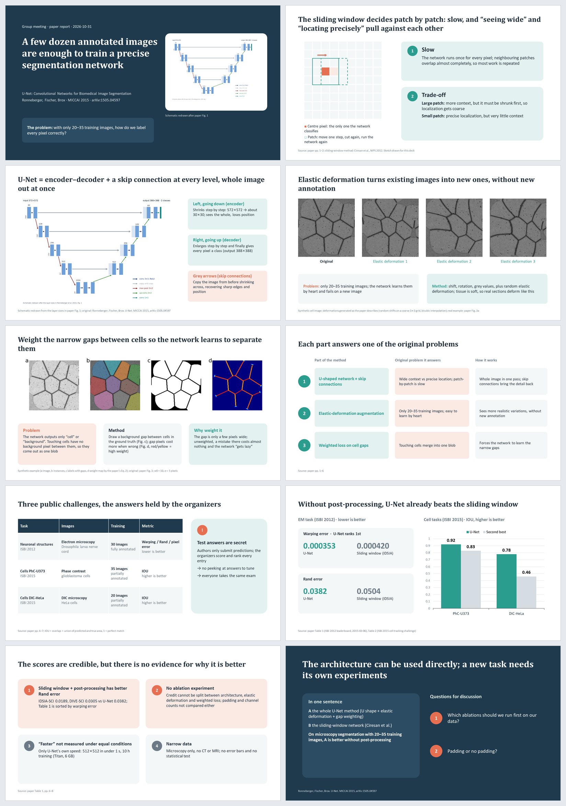

[English](README.md) · [中文](README_cn.md)

# stepaper

**A [Durweg](https://github.com/durweg/durweg) workflow for anyone who has to understand a research paper and present it at a group meeting: instead of handing you a pile of summary, the AI agent goes through the paper with you one step at a time, asks whether you understood, lets you question every step, and only then builds the slides.**

It starts from the paper's core problem, follows step by step how the researchers solved it, and keeps asking back: was this core problem really solved? It was made with Durweg's own guide write-your-method and tried on the U-Net paper (Ronneberger et al., MICCAI 2015). The whole story is on the **[case page](https://claude.ai/artifact/8k8yQWw4c8UEvyqktYbAQk)** (English, with a switch to Chinese; a copy is in this repository: [case/stepaper-case.html](case/stepaper-case.html)). The workflow's step texts are in Chinese; the agent asks at the start which language the run uses.

## 📥 The finished slides

What one run produces: the 10-slide group-meeting deck for the U-Net paper, with speaker notes on every slide.

**Download:** [⬇ English (.pptx)](https://github.com/durweg/durweg-stepaper/raw/main/case/slides/unet-group-meeting-en.pptx) · [⬇ 中文 (.pptx)](https://github.com/durweg/durweg-stepaper/raw/main/case/slides/unet-group-meeting-zh.pptx) · [⬇ Deutsch (.pptx)](https://github.com/durweg/durweg-stepaper/raw/main/case/slides/unet-group-meeting-de.pptx)

The figures on these slides are redrawn or synthetic, so they can be shared; the slides name the paper figure each one stands for.

## 🧭 Install

You need Durweg first ([install Durweg](https://github.com/durweg/durweg/blob/main/README.md)).

1. **Open a terminal** (as in step 1 of Durweg's "Every day").
2. **Add it to your library:** `durweg library add stepaper` (from the [public catalog](https://github.com/durweg/durweg-workflows)), or by address: `durweg library add https://github.com/durweg/durweg-stepaper.git --name stepaper`.
   It downloads the workflow to `~/Durweg/workflows/stepaper/` and registers it. This needs git;
   without git, click **Code → Download ZIP** on GitHub, unzip it to a folder and run
   `durweg library add <that folder> --name stepaper`.

Done looks like this: it prints `added stepaper`, and `durweg library list` lists `stepaper`.

## 📅 Use it

Put the paper's PDF in a folder, start your agent in that folder and tell it: "Run stepaper with durweg." It first asks which language to use (for example Chinese, English or German).

## 🪜 The 8 steps

| # | Step | Delivers | You decide |
| :--- | :--- | :--- | :---: |
| 1 | Choose the language | The language of this run | ✅ |
| 2 | Find the core claim | The concrete problem the paper solves and what it claims | ✅ |
| 3 | Read step by step, question every step | Discussion notes: key points, your questions and answers, your retellings and views | ✅ |
| 4 | Metrics guide | One short paragraph per metric: what it is for, how to read it | ✅ |
| 5 | Retell and judge | Your one-sentence retelling (A vs B), your judgement and reservations | ✅ |
| 6 | Outline the slides | Each slide's one-sentence title and the figure or numbers on it | ✅ |
| 7 | Make the slides | The slide deck, with speaker notes | |
| 8 | Rehearse and check | The corrected deck and the list of problems fixed | ✅ |

## 🙋 I want to …

| I want to | How |
| :--- | :--- |
| See how this workflow was made | [case page](https://claude.ai/artifact/8k8yQWw4c8UEvyqktYbAQk) |
| Read the full U-Net example | [method](case/materials/en/01-method.md), [discussion notes](case/materials/en/04-walkthrough.md), [metrics guide](case/materials/en/05-metrics.md), [retell and judge](case/materials/en/06-retell-judge.md); all materials: [case/materials/index.html](case/materials/index.html) |
| Make it my own | Make your own version with Durweg's write-your-method, or edit `workflow.json` and `skills/stepaper/SKILL.md` following the [workflow format](https://github.com/durweg/durweg/blob/main/docs/workflow-format.md) |
| Stop using it | `durweg library remove stepaper`, then delete `~/Durweg/workflows/stepaper/` |

---

License: [MIT](LICENSE).
