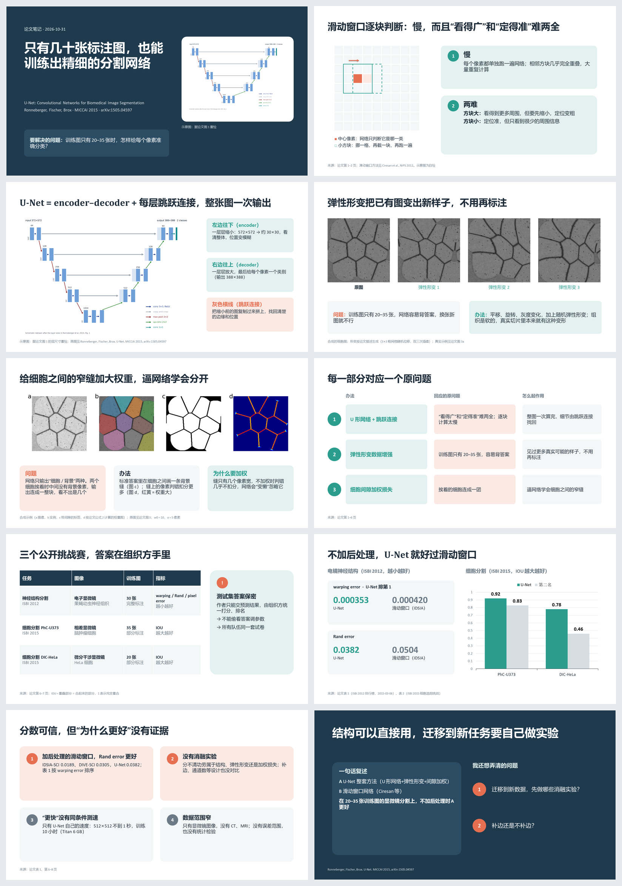

[English](README.md) · [中文](README_cn.md)

# stepaper

**一个 [Durweg](https://github.com/durweg/durweg) 工作流，给想真正读懂一篇论文的人：AI agent 不是丢给你一大堆总结，而是陪你一步一步读，每一步问你看懂没有、让你质疑，最后才做 PPT，用来检验你懂了没有。**

它从论文的核心问题出发，一步一步看研究人员是怎么做的，并且不断反问：这个核心问题真的解决了吗？它是用 Durweg 自带的引导 write-your-method 做出来的，用 U-Net 论文（Ronneberger 等，MICCAI 2015）试跑过。整个过程见**[案例网页](case/stepaper-case.html)**（中英文可以切换，默认英文；下载后打开）。工作流的步骤说明是中文；每次运行开始时，agent 会先问你用什么语言。

## 📥 做出来的 PPT

一次运行的成品：U-Net 论文的 10 页 PPT，每页都有讲稿备注。

**下载：** [⬇ 中文（.pptx）](https://github.com/durweg/durweg-stepaper/raw/main/case/slides/unet-slides-zh.pptx) · [⬇ English (.pptx)](https://github.com/durweg/durweg-stepaper/raw/main/case/slides/unet-slides-en.pptx) · [⬇ Deutsch (.pptx)](https://github.com/durweg/durweg-stepaper/raw/main/case/slides/unet-slides-de.pptx)

PPT 里的图都是重绘的示意图或合成图，可以公开分享；每张图都注明了它对应论文的哪张图。

## 🧭 安装

需要先装好 Durweg（[安装 Durweg](https://github.com/durweg/durweg/blob/main/README_cn.md)）。

1. **打开终端**（和 Durweg 的“每天怎么用”第 1 步一样）。
2. **装进方法库：** `durweg library add stepaper`（从[公开目录](https://github.com/durweg/durweg-workflows)安装），或者按地址：`durweg library add https://github.com/durweg/durweg-stepaper.git --name stepaper`。它会把工作流下载到 `~/Durweg/workflows/stepaper/` 并登记。需要电脑上有 git；没有 git 的话，在 GitHub 页面点 **Code → Download ZIP**，解压到一个文件夹，再运行 `durweg library add <那个文件夹> --name stepaper`。

看到 `added stepaper`，并且 `durweg library list` 里有 `stepaper`，就装好了。

## 📅 怎么用

把论文 PDF 放进一个文件夹，在这个文件夹里启动 agent，对它说：“用 durweg 运行 stepaper”。它会先问你用什么语言（例如中文、英文、德语）。

## 🪜 8 个步骤

| # | 步骤 | 交出什么 | 由你决定 |
| :--- | :--- | :--- | :---: |
| 1 | 选择语言 | 这次运行用的语言 | ✅ |
| 2 | 找到核心论点 | 论文要解决的具体问题和它的主张 | ✅ |
| 3 | 一步一步读，每步追问 | 讨论笔记：要点、你的提问与回答、你的复述和见解 | ✅ |
| 4 | 指标说明 | 每个指标一小段：干什么用、怎么看好坏 | ✅ |
| 5 | 复述与判断 | 你的一句话复述（A 对 B）、判断和保留 | ✅ |
| 6 | 列 PPT 大纲 | 每页的一句话标题和要放的图或数字 | ✅ |
| 7 | 做页面 | PPT 文件，带讲稿备注 | |
| 8 | 试讲检查 | 改好的 PPT 和问题清单 | ✅ |

## 🙋 我想……

| 我想 | 怎么做 |
| :--- | :--- |
| 看这个工作流是怎么做出来的 | [案例网页](case/stepaper-case.html) |
| 读完整的 U-Net 例子 | [方法](case/materials/zh/01-method.md)、[讨论笔记](case/materials/zh/04-walkthrough.md)、[指标说明](case/materials/zh/05-metrics.md)、[复述与判断](case/materials/zh/06-retell-judge.md)；全部材料：[case/materials/index.html](case/materials/index.html) |
| 改成自己的版本 | 用 Durweg 的 write-your-method 做你自己的版本，或者按[工作流格式](https://github.com/durweg/durweg/blob/main/docs/workflow-format.md)修改 `workflow.json` 和 `skills/stepaper/SKILL.md` |
| 不再使用 | `durweg library remove stepaper`，再删掉 `~/Durweg/workflows/stepaper/` |

---

许可证：[MIT](LICENSE)。
